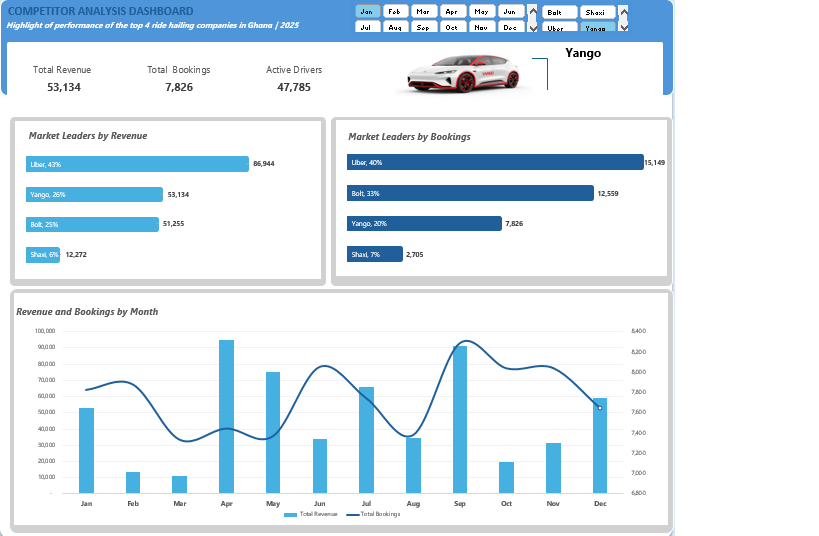
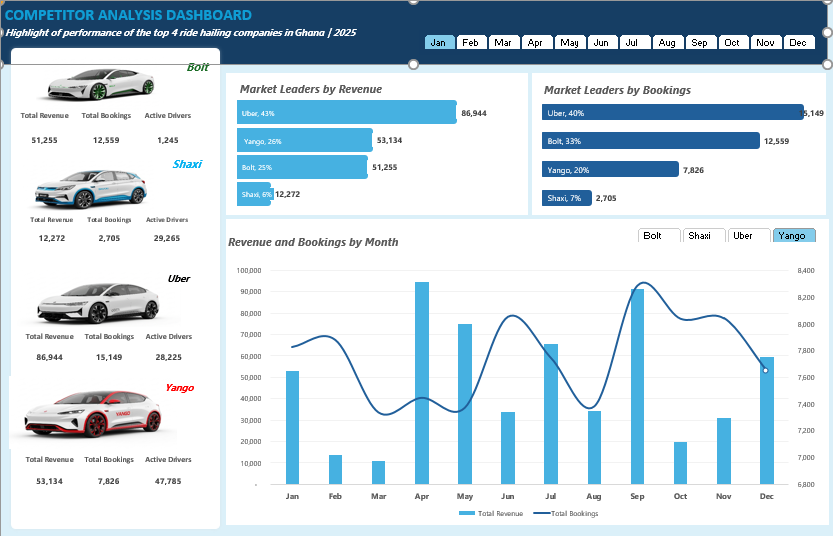

Ghana Ride-Hailing Competitor Analysis Dashboard
An Excel dashboard project analyzing the performance of leading ride-hailing companies in Ghana in 2025.

Project Overview
This project involved using Microsoft Excel to analyze and compare the performance of four ride-hailing companies: Bolt, Shaxi, Uber, and Yango.

Using the same dataset, I created two dashboard versions to examine the data from different perspectives and present key business metrics in a clear, visual format.

Key Performance Indicators (KPIs)
The dashboards highlight three major performance indicators:

Total Revenue: Revenue generated by each ride-hailing company.

Total Bookings: The number of bookings recorded.

Active Drivers: The number of active drivers.

Dashboard Features
Comparison of ride-hailing companies by revenue.

Comparison of companies by total bookings.

Analysis of revenue and bookings by month.

Interactive filters for months and ride-hailing companies.

Two dashboard layouts developed from the same dataset.

Key Insights
The dashboards allow users to compare the companies' performance in terms of revenue, bookings, and active drivers. They also provide a view of monthly performance and how the market leaders differ across the selected metrics.

## Dashboard Previews

### Dashboard Version 1

### Dashboard Version 2

Tools and Skills
Microsoft Excel

Data analysis and data visualization

PivotTables and KPI reporting

Interactive dashboard design

Competitor performance analysis

Project Objective
The objective of this project was to transform ride-hailing data into interactive dashboards that make it easier to compare competitors, examine performance trends, and support data-driven business decisions.

